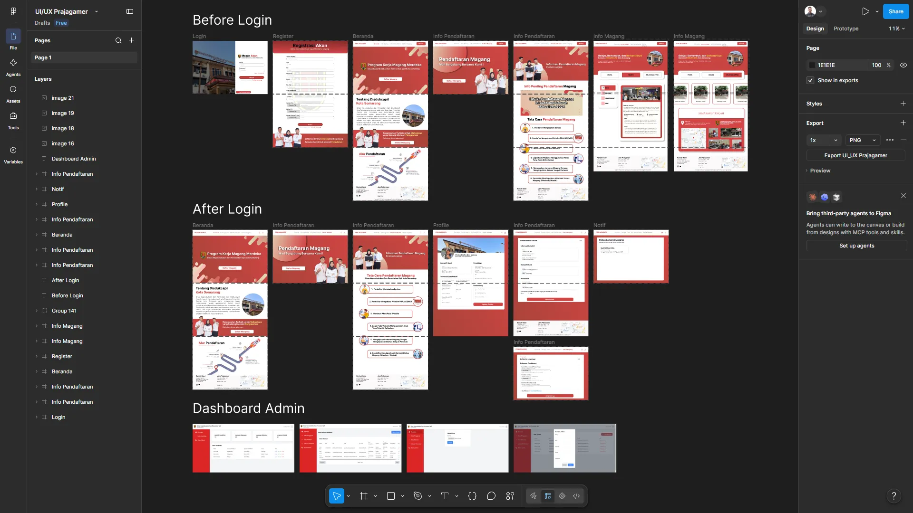
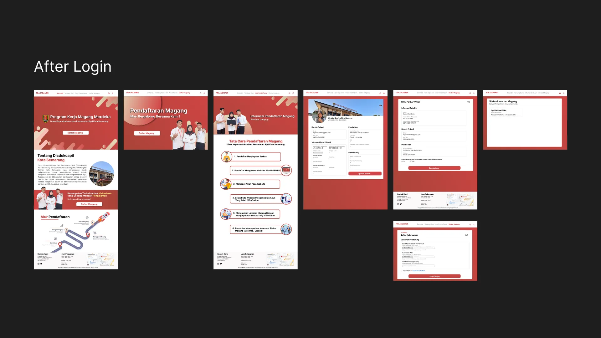
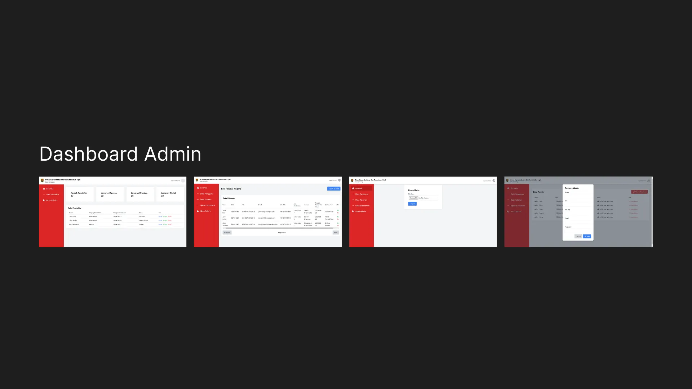

# Prajagamer Website UIUX Design

## Project Overview

**Prajagamer Website UIUX Design** is a high-fidelity web and administrative dashboard interface design created in Figma for **PRAJAGAMER** (*Program Kerja Magang Merdeka*), the internship recruitment and management portal of **Dinas Kependudukan dan Pencatatan Sipil (Disdukcapil) Kota Semarang**. The project designs a complete multi-role digital experience covering pre-authentication public exploration, authenticated student application workflows, and internal administrative monitoring across 18 structured web frames.

## Problem Statement & Objectives

Prospective student interns seeking *Magang Merdeka* placements at Disdukcapil Kota Semarang need clear guidance on institutional divisions, required application documents, and real-time application status updates, while agency staff require an organized backend interface to track submissions and manage administrator accounts. This design project addresses those operational needs through an approachable public portal paired with a dedicated administrative console.

- Establish a clear, step-by-step onboarding journey so prospective applicants understand registration requirements before creating an account.
- Separate public informational browsing (`Before Login`) from authenticated submission and status tracking (`After Login`) to reduce cognitive clutter.
- Structure a two-stage internship application form (`1/2` personal and academic details, `2/2` supporting document uploads) for cleaner data entry.
- Provide Disdukcapil administrators with a consolidated dashboard featuring application summary counters, searchable applicant tables, Excel export controls, media upload tools, and admin account management.

## Project Type & Design Approach

The project focuses on high-fidelity web interface design and role-based user experience architecture for a civic internship platform. Screens are organized on a single Figma workspace (`UI/UX Prajagamer`) into three distinct access states representing the full lifecycle of an internship application.

| Attribute | Description |
| :--- | :--- |
| **Project Type** | Web & Dashboard UI/UX Design |
| **Supporting Discipline** | Information Architecture, Form Design, Admin Dashboard Design |
| **Design Approach** | Role-Based User-Centered Design (`Before Login`, `After Login`, `Dashboard Admin`) |
| **Target Platform** | Web (Desktop Portal & Administrative Console) |
| **Primary Tool** | Figma |
| **Main Deliverable** | 18 High-Fidelity Web & Dashboard UI Screens (Exported as WebP Showcases) |

## Target Audience & User Needs

Based on the interface screens and data fields designed within the portal, the system serves two primary user groups involved in Disdukcapil Kota Semarang's internship program. Because this repository archives final Figma visual exports without separate field research transcripts or usability test logs, validated empirical user metrics were not established.

- **Prospective & Registered Student Interns:** University students (such as applicants submitting NIM, NIK, university, major, CV, photo, and academic transcripts) who need institutional context, clear registration steps, profile management, and transparent application status notifications (`Diterima` / `Ditolak` / `Dalam Proses`).
- **Disdukcapil Internship Administrators & Superadmins:** Agency staff (`superadmin`) responsible for reviewing incoming applications, filtering applicant records, exporting applicant datasets to Excel, uploading informational photos, and adding new administrator accounts.

## Design Scope & Deliverables

The repository contains consolidated high-fidelity visual exports captured directly from the Figma workspace, organizing all 18 web screens by authentication and role context.

| Deliverable | Description | Status / Location |
| :--- | :--- | :--- |
| **Figma Workspace Overview** | Full canvas snapshot showing all three screen groups, layer hierarchy, and export configuration | Completed — [screenshots/banner.webp](screenshots/banner.webp) |
| **Before Login Public Portal** | 7 high-fidelity screens (`Login`, `Register`, `Beranda`, `Info Pendaftaran` x2, `Info Magang` x2) | Completed — [screenshots/image1.webp](screenshots/image1.webp) |
| **After Login Applicant Portal** | 7 high-fidelity screens (`Beranda`, `Info Pendaftaran` x2, `Profile`, `Form Pendaftaran` 1/2 & 2/2, `Notif`) | Completed — [screenshots/image2.webp](screenshots/image2.webp) |
| **Admin Management Console** | 4 high-fidelity screens (`Dashboard Overview`, `Data Pelamar Magang`, `Upload Foto`, `Data Admin` modal) | Completed — [screenshots/image3.webp](screenshots/image3.webp) |

## Information Architecture & Sitemap

The portal separates navigation into three distinct role-based environments so visitors, registered applicants, and agency staff only see actions relevant to their current state. Public users transition from informational pages into account registration, authenticated applicants gain access to profile editing and multi-step submissions, and administrators operate inside a sidebar-driven console.

```mermaid
flowchart TD
    Root["PRAJAGAMER Web Portal"] --> PreAuth["Before Login (Public Portal)"]
    Root --> PostAuth["After Login (Applicant Portal)"]
    Root --> Admin["Dashboard Admin (Staff Console)"]

    PreAuth --> Login["Login (Masuk Akun)"]
    PreAuth --> Register["Register (Registrasi Akun)"]
    PreAuth --> PreHome["Beranda (Disdukcapil Overview & Alur)"]
    PreAuth --> PreInfoP["Info Pendaftaran (Overview & 6-Step Guide)"]
    PreAuth --> PreInfoM["Info Magang (Profil, Bidang, Pelayanan TPDK)"]

    PostAuth --> PostHome["Beranda (Authenticated Landing)"]
    PostAuth --> PostInfoP["Info Pendaftaran (Guide & CTA)"]
    PostAuth --> Profile["Profile (Biodata, Education, Supervisor)"]
    PostAuth --> Apply["Daftar Magang (Form 1/2 & Upload 2/2)"]
    PostAuth --> Notif["Notif (Status Lamaran Magang)"]

    Admin --> AdminHome["Beranda (KPI Summary & Data Pendaftar)"]
    Admin --> AdminApplicants["Data Pelamar Magang & Export to Excel"]
    Admin --> AdminMedia["Upload Foto (Information Media)"]
    Admin --> AdminUsers["Data Admin & Tambah Admin Modal"]
```

## Design Solution & Key Features

The visual solution pairs a crimson-and-white civic identity inspired by Disdukcapil Kota Semarang with structured card layouts, illustrated onboarding flows, and uncluttered administrative tables. Note that these screens represent static high-fidelity Figma UI designs rather than a live interactive codebase.

- **Split-Screen Authentication & Comprehensive Registration:** The `Login` screen pairs an institutional Disdukcapil building backdrop with a clean sign-in card, while `Register` captures full identity, academic metadata (`NIM`, `NIK`, `Asal Universitas`, `Jurusan`), and direct file inputs for photo, CV, and academic transcript uploads.
- **Visualized 4-Step & 6-Step Application Roadmaps:** Both `Beranda` and `Info Pendaftaran` translate bureaucratic internship procedures into numbered visual steps (`Buat Akun`, `Kategori Magang`, `Pengajuan Magang`, `Status Magang`) supported by custom illustrations and clear calls to action.
- **Tabbed Agency & Office Directory (`Info Magang`):** Dedicated tabs (`Profil`, `Bidang`, `Pelayanan TPDK`) organize Disdukcapil departmental descriptions (`PIAK`, `DAPDUK`, `SEKRETARIAT`, `PDIP`), regional office galleries such as `Semarang Tengah`, and an embedded contact/location footer.
- **Two-Stage Authenticated Application Wizard:** After login, applicants can maintain their `Profile` (personal info, education, academic supervisor) and submit applications through a progressive two-step flow (`1/2 Form Pendaftaran` and `2/2 Daftar ke Lowongan` with recommendation letter, CV, and optional portfolio link).
- **Real-Time Status Card & Admin Action Controls:** Applicants view outcome notices inside `Notif` (`Status Lamaran Magang`), while administrators use `Dashboard Admin` KPI cards (`Jumlah Pendaftar`, `Lamaran Diproses`, `Lamaran Diterima`, `Lamaran Ditolak`), `Export to Excel`, `Upload Foto`, and the `Tambah Admin` modal.

## Design Workflow

1. **Role & Journey Segmentation:** Divided the portal architecture on Figma `Page 1` into three clear horizontal tiers—`Before Login`, `After Login`, and `Dashboard Admin`—captured in [screenshots/banner.webp](screenshots/banner.webp).
2. **Public Onboarding & Civic Branding:** Designed the `Beranda`, `Info Pendaftaran`, `Info Magang`, `Login`, and `Register` screens in [screenshots/image1.webp](screenshots/image1.webp) using Disdukcapil Kota Semarang photography, crimson headers (`#C14440`), and illustrated process guides.
3. **Authenticated Applicant Flow Design:** Extended the public shell with authenticated header controls (`Profile` and `Notif` icons), structured biodata management, and the two-step `Daftar Magang` submission screens in [screenshots/image2.webp](screenshots/image2.webp).
4. **Administrative Console Design:** Built the sidebar-based `Dashboard Admin` workspace in [screenshots/image3.webp](screenshots/image3.webp) with KPI summary metrics, paginated applicant tables, file upload views, and an account creation modal.
5. **Visual Showcase Consolidation:** Organized and exported the three grouped screen showcases and full Figma workspace overview into WebP assets inside [screenshots/](screenshots/).

## Design Tools & Tech Stack

| Category | Tool / Technology | Purpose |
| :--- | :--- | :--- |
| **UI/UX Design** | Figma | High-fidelity screen layout, multi-role flow organization, and component styling |
| **Visual Export** | WebP / PNG | Compressed high-resolution showcase exports (`banner.webp`, `image1.webp`–`image3.webp`) |
| **Documentation & Versioning** | Markdown / Git | Structured project documentation and asset version control |

## Design Preview

### 1. Public Portal & Pre-Authentication Flows (Before Login)

The pre-authentication suite establishes institutional trust and clear onboarding across seven screens: split-layout `Login`, multi-field `Register` with document upload inputs, the `Beranda` landing page featuring Disdukcapil Kota Semarang's overview and 4-step registration path, `Info Pendaftaran` with a 6-step illustrated guide, and tabbed `Info Magang` views (`Profil`, `Bidang`, `Pelayanan TPDK`) with division details and Semarang Tengah office location maps.

### 2. Applicant Portal, Profile & Application Flows (After Login)

Once signed in, the top navigation bar introduces notification and profile icons while unlocking personalized workflows across seven screens: authenticated `Beranda` and `Info Pendaftaran`, a structured `Profile` page organizing personal data, education, and supervisor contacts, a two-step `Form Pendaftaran` (`1/2`) and `Daftar ke Lowongan` (`2/2`) document submission flow, and a focused `Notif` card displaying `Status Lamaran Magang`.

### 3. Administrative Management Console (Dashboard Admin)

The internal management console pairs a fixed crimson sidebar (`#DC2626`) with a cool gray workspace (`#F3F5F7`) across four views: an overview dashboard summarizing total applicants and review statuses alongside quick `Lihat` / `Terima` / `Tolak` row actions, a full `Data Pelamar Magang` table with `Export to Excel` and pagination, an `Upload Foto` media utility, and a `Data Admin` directory with an overlaid `Tambah Admin` modal form.

## Contributing

Contributions to improve documentation clarity, organize design assets, or refine layout references are welcome through the following workflow:

1. Fork the repository.
2. Create a branch for the change.
3. Make the changes.
4. Check that relevant design files, assets, and documentation are organized correctly.
5. Commit and push the branch.
6. Open a pull request with a clear explanation and relevant previews when applicable.

## License

This project is licensed under the MIT License.
See the [LICENSE](LICENSE) file for details.

## Author & Contact

**Yohanes Dimas Pratama**

- GitHub: [github.com/weztcy](https://github.com/weztcy)
- Portfolio: [yohanesdimas.com](https://yohanesdimas.com)
- LinkedIn: [linkedin.com/in/yohanes-dimas](https://www.linkedin.com/in/yohanes-dimas)
