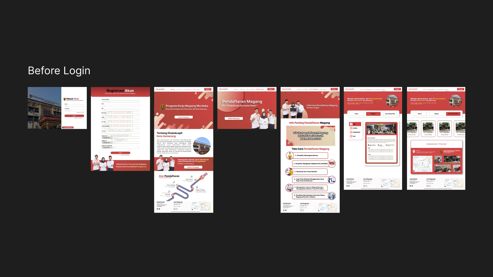

# Prajagamer Website UIUX Design

## Project Overview

**Prajagamer Website UIUX Design** is a web-based UI/UX design project created in Figma for **PRAJAGAMER** (*Program Kerja Magang Merdeka*), the internship recruitment and management portal of **Dinas Kependudukan dan Pencatatan Sipil (Disdukcapil) Kota Semarang**. The design establishes a unified visual language and structured user experience across 18 high-fidelity desktop screens, supporting public program discovery before login, authenticated internship application workflows for university students, and centralized applicant evaluation for agency administrators.

## Problem Statement & Objectives

Prospective student interns seeking placements at government institutions often face fragmented registration instructions, unclear document requirements, and opaque application tracking, while administrative staff need a structured workspace to inspect submissions and manage review outcomes without manual spreadsheet overhead.

The core objectives of this design project are:
- Establish a clear, approachable public portal presenting Disdukcapil Kota Semarang's profile, internship divisions, service locations, and step-by-step registration requirements prior to sign-in.
- Streamline applicant onboarding through an integrated registration form that captures academic details alongside initial document uploads (photo, CV, and academic transcript).
- Provide authenticated applicants with a dedicated workspace to maintain personal and advisor records, complete a guided two-step application form, and monitor acceptance or rejection notifications.
- Equip internal staff with a dedicated administrative dashboard featuring submission metrics, searchable applicant tables, Excel data export hooks, announcement photo uploads, and admin account management.

## Project Type & Design Approach

The project centers on **Web UI/UX Design** organized around distinct user authentication states and operational roles. Rather than designing isolated marketing pages, the workspace structures end-to-end screen flows across pre-login discovery, post-login self-service, and back-office administration.

| Attribute | Description |
| :--- | :--- |
| **Project Type** | Web Design |
| **Supporting Discipline** | User Flow & Information Architecture Design |
| **Design Approach** | User-Centered & Role-Based Multi-Flow Design |
| **Target Platform** | Web (Desktop Browser) |
| **Primary Tool** | Figma |
| **Main Deliverable** | 18 High-Fidelity Web UI Screens across 3 Role Flows |

## Target Audience & User Needs

The interface is designed around two primary user groups interacting with the Disdukcapil Kota Semarang internship program. Because no formal empirical research logs or interview transcripts are archived in this repository, the user needs below reflect the functional requirements embedded in the designed screens rather than validated field research findings.

- **Prospective University & Vocational Student Interns:** Need transparent eligibility timelines, clear visual registration steps, a straightforward account sign-up and profile editor, a guided two-step application submission flow, and immediate visibility into their application review status.
- **Disdukcapil Administrative Staff & Superadmins:** Need an at-a-glance summary of total applicants and review statuses, structured applicant tables with document inspection and accept/reject actions, spreadsheet export capability, content image publishing, and role-based admin account provisioning.

## Design Scope & Deliverables

This repository preserves the exported high-fidelity Figma canvas overview and role-grouped screen boards in WebP format. Source `.fig` files, low-fidelity wireframes, interactive prototype links, and usability test reports are not stored in the repository.

| Deliverable | Description | Status / Location |
| :--- | :--- | :--- |
| **Figma Workspace Canvas** | Full overview of the `UI/UX Prajagamer` Figma project showing layers, canvas groups, and all 18 frames | Completed ([`screenshots/banner.webp`](screenshots/banner.webp)) |
| **Before Login Screen Set** | 7 public and onboarding screens (`Login`, `Register`, `Beranda`, `Info Pendaftaran`, and `Info Magang`) | Completed ([`screenshots/image1.webp`](screenshots/image1.webp)) |
| **After Login Screen Set** | 7 authenticated applicant screens (`Beranda`, `Info Pendaftaran`, `Profile`, 2-step `Form Pendaftaran`, and `Notif`) | Completed ([`screenshots/image2.webp`](screenshots/image2.webp)) |
| **Dashboard Admin Screen Set** | 4 back-office portal views (`Beranda` KPIs, `Data Pelamar Magang`, `Upload Foto`, and `Data Admin` + `Tambah Admin` modal) | Completed ([`screenshots/image3.webp`](screenshots/image3.webp)) |

## Information Architecture & Sitemap

The information architecture divides the web application into three clear operational zones mapped directly to the Figma canvas groups: public pre-authentication pages, authenticated applicant screens, and the administrative management portal.

```mermaid
flowchart TD
    Root["PRAJAGAMER Web Portal"] --> Pre["Before Login (Public Portal)"]
    Root --> Post["After Login (Applicant Portal)"]
    Root --> Admin["Dashboard Admin (Staff Portal)"]

    Pre --> PreHome["Beranda (Hero & 4-Step Alur)"]
    Pre --> PreInfo["Info Pendaftaran (Announcement & 6-Step Guide)"]
    Pre --> PreMagang["Info Magang (Profil, Bidang, Pelayanan TPDK)"]
    Pre --> PreAuth["Login & Registrasi Akun"]

    Post --> PostHome["Beranda & Info Pendaftaran (Authenticated)"]
    Post --> PostProfile["Profile (Personal, Education & Advisor Info)"]
    Post --> PostForm["Daftar Magang (2-Step Form & Document Upload)"]
    Post --> PostNotif["Notif (Status Lamaran Magang)"]

    Admin --> AdminHome["Beranda (KPI Cards & Data Pendaftar Table)"]
    Admin --> AdminPelamar["Data Pelamar Magang (Full Table & Excel Export)"]
    Admin --> AdminUpload["Upload Foto (Information Publishing)"]
    Admin --> AdminAccounts["Akun Admin (Admin Table & Tambah Admin Modal)"]
```

## Design Solution & Key Features

The visual solution establishes a cohesive civic brand identity centered on Disdukcapil Kota Semarang's crimson-red and clean white palette, ensuring clear distinction between informational content, calls to action, and administrative controls.

- **Consistent Brand & Civic Identity:** Pairs institutional photography of the Disdukcapil Kota Semarang building with crimson-red hero banners (`#C84441` / `#DC2626`), dark charcoal typography, and white content cards.
- **Visualized Onboarding & Registration Guidance:** Replaces dense text walls with a 4-stage roadmap infographic on the landing page and a 6-step illustrated sequence on the `Info Pendaftaran` page.
- **Tabbed Institutional Discovery:** Organizes agency details under `PROFIL`, `BIDANG` (`PIAK`, `DAFDUK`, `SEKRETARIAT`, `PDIP`), and `PELAYANAN TPDK` tabs alongside a Semarang Tengah office gallery and location map.
- **Guided Two-Step Internship Application:** Splits application intake into `1/2` personal/placement preferences and `2/2` supporting document uploads (`Surat Rekomendasi Permohonan`, `Curriculum Vitae`, optional portfolio URL, and terms consent) to reduce form fatigue.
- **Dedicated Status Notification & Profile Maintenance:** Adds bell and profile navigation icons after login for instant access to `Status Lamaran Magang` updates and editable student/advisor records.
- **Actionable Admin Dashboard:** Implements a persistent red left sidebar (`Beranda`, `Data Pendaftar` / `Data Pengguna`, `Data Pelamar`, `Upload Informasi`, `Akun Admin`), four status KPI counters, inline `Lihat` / `Terima` / `Tolak` table actions, Excel export, and a centered `Tambah Admin` modal overlay.

## Design Workflow

Based on the canvas structure and exported screen boards visible in the `UI/UX Prajagamer` Figma file, the design workflow progressed through the following stages:

1. **Role & Canvas Structuring:** Organized the Figma workspace (`Page 1`) into three horizontal user-role rows (`Before Login`, `After Login`, and `Dashboard Admin`) to separate public, student, and staff journeys.
2. **Pre-Authentication Public Portal Design:** Created the split-screen `Login` page, multi-field `Register` form with document upload inputs, public `Beranda` landing page, `Info Pendaftaran` announcement and 6-step guide, and tabbed `Info Magang` institutional profiles ([`screenshots/image1.webp`](screenshots/image1.webp)).
3. **Authenticated Applicant Flow Design:** Adapted the navigation header for signed-in students with notification and profile icons, then designed the `Profile` management view, the two-step `Form Pendaftaran` (`1/2` and `2/2`), and the `Status Lamaran Magang` notification page ([`screenshots/image2.webp`](screenshots/image2.webp)).
4. **Administrative Dashboard Design:** Built the back-office web layout featuring a fixed crimson sidebar, KPI summary cards, paginated `Data Pelamar Magang` table with `Export to Excel`, `Upload Foto` utility, and `Data Admin` management with the `Tambah Admin` modal ([`screenshots/image3.webp`](screenshots/image3.webp)).
5. **Presentation Export:** Exported the full Figma workspace overview (`banner.webp`) and the three role-specific screen boards (`image1.webp`–`image3.webp`) in WebP format for portfolio documentation.

## Design Tools & Tech Stack

| Category | Tool / Technology | Purpose |
| :--- | :--- | :--- |
| **UI/UX Design** | Figma | Designing all 18 high-fidelity desktop screens, layout grids, forms, tables, and modal overlays |
| **Asset Export** | WebP | Storing compressed high-resolution screen boards and Figma workspace previews in `screenshots/` |
| **Documentation** | Markdown & Mermaid | Documenting project scope, design workflow, and role-based information architecture |

## Design Preview

### 1. Pre-Authentication Public Portal & Registration Flow (Before Login)

This board presents the 7 public-facing screens designed for prospective interns before signing in, covering the split-screen `Masuk Akun` login view, the comprehensive `Registrasi Akun` form with photo/CV/transcript uploads, the `Beranda` landing page with its 4-step registration roadmap, and the `Info Pendaftaran` guide. It also showcases the tabbed `Info Magang` (`PROFIL`, `BIDANG`, `PELAYANAN TPDK`) pages that organize Disdukcapil Kota Semarang division duties and Semarang Tengah office locations with clear visual hierarchy.

### 2. Authenticated Applicant Portal, Multi-Step Application & Status Tracking (After Login)

This collection illustrates the 7 post-login screens tailored for registered students, updating the top navigation bar with notification bell and profile icons for seamless movement across self-service tasks. Key interfaces include the structured `Profile` editor for personal, academic, and advisor data, the two-step `Form Pendaftaran` (`1/2` placement willingness and `2/2` supporting document submission), and the dedicated `Status Lamaran Magang` notification card.

### 3. Administrative Review & Applicant Management Portal (Dashboard Admin)

This set displays the 4 back-office admin screens anchored by a persistent crimson-red sidebar (`Beranda`, `Data Pendaftar` / `Data Pengguna`, `Data Pelamar`, `Upload Informasi`, `Akun Admin`) and a light neutral content canvas (`#F3F5F7`). Staff can monitor four live KPI counters (`Jumlah Pendaftar`, `Lamaran Diproses`, `Lamaran Diterima`, `Lamaran Ditolak`), review and act on applicant records with `Export to Excel` and pagination controls, upload informational photos, and add new administrators via the centered `Tambah Admin` modal dialog.

## Contributing

Contributions to refine interface screens, accessibility contrast, or documentation are welcome through standard Git workflow practices:

1. Fork the repository.
2. Create a branch for the change.
3. Make the changes.
4. Check that relevant design files, assets, and documentation are organized correctly.
5. Commit and push the branch.
6. Open a pull request with a clear explanation and relevant previews when applicable.

## License

This project is licensed under the MIT License.
See the [LICENSE](LICENSE) file for details.

## Author & Contact

**Yohanes Dimas Pratama**

- GitHub: [github.com/weztcy](https://github.com/weztcy)
- Portfolio: [yohanesdimas.com](https://yohanesdimas.com)
- LinkedIn: [linkedin.com/in/yohanes-dimas](https://www.linkedin.com/in/yohanes-dimas)
