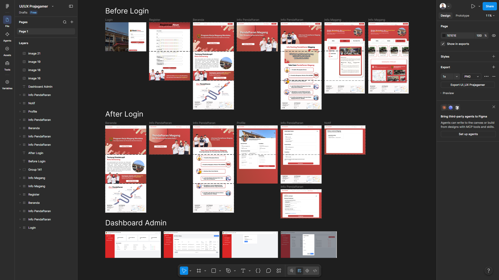
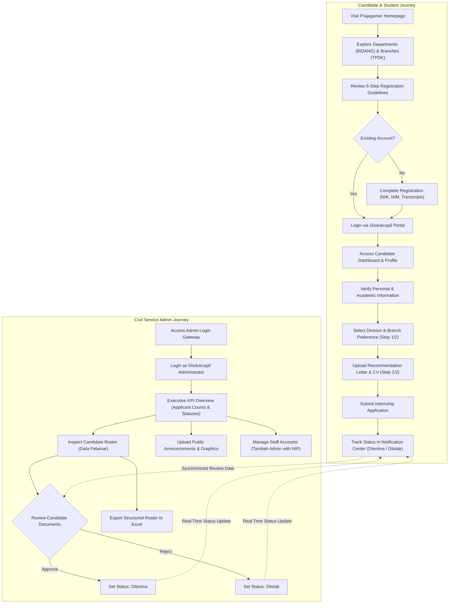

# Prajagamer Website UI/UX Design

## Project Description

**Prajagamer** (*Praktik Kerja dan Magang Merdeka*) is a comprehensive web-based internship registration, document submission, and administrative management platform designed for the **Dinas Kependudukan dan Pencatatan Sipil (Disdukcapil) Kota Semarang** (Department of Population and Civil Registration of Semarang City, Indonesia). Designed to replace fragmented manual paperwork and unstandardized offline internship submissions, Prajagamer delivers an integrated digital service ecosystem tailored to both university student applicants and civil service internship coordinators.

The platform bridges public transparency with administrative rigor: students can explore departmental divisions, verify internship criteria across municipal branch offices (*Tempat Pelayanan Administrasi Kependudukan / TPDK*), complete multi-step verified applications, and monitor their acceptance status in real time. Concurrently, Disdukcapil administrators utilize a secure back-office dashboard featuring high-level operational telemetry, applicant status toggles, Excel roster exports, and role-based staff account governance.

This repository contains high-fidelity desktop web interface designs, structural user flows, design system foundations, and composite showcase mockups created in Figma.

---

## Project Overview

Internship recruitment within regional governmental agencies often suffers from opaque information distribution, physical document bottlenecks, and disorganized candidate tracking across distinct departments. Students seeking certified internship credit under the *Program Kerja Magang Merdeka* initiative frequently struggle to identify which municipal divisions accept their academic major or locate where specific administrative sub-district branch offices operate.

The **Prajagamer Web Platform** addresses these challenges through a two-sided digital architecture:

1. **Candidate & Public Web Portal**: An informative, accessible public interface that introduces the Disdukcapil organization, outlines the six-stage internship onboarding process, presents department rosters (`PIAK`, `DAFDUK`, `SEKRETARIAT`, `PDIP`), catalogs regional TPDK branches with interactive map locations, and facilitates streamlined multi-step application submissions with PDF document uploads.
2. **Civil Service Administrative Dashboard**: A secure back-office workspace empowering Disdukcapil administrators to review incoming submissions, track real-time recruitment metrics (Total Applicants, In Process, Accepted, Rejected), export structured candidate records to Excel for official government archiving, and manage authorized administrative accounts.

### Design Deliverables & Repository Assets

All visual deliverables and presentation assets are located in the `screenshots/` directory:
- **Presentation Hero Banner** (`./screenshots/banner.png`): High-resolution overview of the Figma canvas exhibiting the end-to-end information hierarchy, grouping artboards across *Before Login*, *After Login*, and *Dashboard Admin* workflows.
- **Screen Flow Showcase 1 — Student & Applicant Flow** (`./screenshots/Prajagamer%20Website%20UI_UX%20Design%201.png`): High-fidelity design sequence illustrating the Post-Login Landing Page, Registration Overview, 6-Step Workflow Guide, Candidate Profile Sheet, 2-Stage Multi-Step Application Form, and Real-Time Application Status Dashboard.
- **Screen Flow Showcase 2 — Public Portal & Onboarding Flow** (`./screenshots/Prajagamer%20Website%20UI_UX%20Design%202.png`): High-fidelity design sequence illustrating the Disdukcapil Split-Screen Login, Watermarked Candidate Registration, Public Homepage, Program Announcement Banner, Division Directory (`BIDANG`), and Regional Service Branch Locator (`PELAYANAN TPDK`).
- **Screen Flow Showcase 3 — Government Admin Dashboard Flow** (`./screenshots/Prajagamer%20Website%20UI_UX%20Design%203.png`): High-fidelity design sequence detailing the Administrative KPI Dashboard, Searchable Candidate Registry Table with Excel Export, Public Announcement Media Uploader, and Admin Staff Account Management Modal.

*Note: This repository contains UI/UX design deliverables, screen mockups, and visual design assets. It does not contain backend server implementations or production web application code.*

---

## Problem Statement & Design Goals

### Problem Statement

- **Manual and Fragmented Submissions**: Prospective student applicants historically had to visit the Disdukcapil office in person or submit physical recommendation letters and hard-copy transcripts, resulting in lost documents and inefficient processing.
- **Opaque Division Requirements**: Students were often unaware of internal departmental functions (e.g., Population Database Administration vs. Civil Registration) and their minimum semester requirements, leading to mismatched placements.
- **Geographic Confusion Regarding Branch Offices**: Disdukcapil Kota Semarang operates numerous TPDK service points across sub-districts. Students lacked clear guidance on branch locations, service hours, and assigned tasks.
- **Administrative Tracking Overhead**: Internship coordinators handled applicant records across disparate paper files and unstructured spreadsheets, complicating performance monitoring and government reporting.

### Design Goals

- **Cohesive Institutional Brand Identity**: Utilize Disdukcapil Kota Semarang's official identity, featuring bold Indonesian red accents, crisp card containers, and clean civic typography that reflects governmental professionalism.
- **Transparent Multi-Tier Information Architecture**: Provide structured directories for municipal departments (`BIDANG`) and branch offices (`PELAYANAN TPDK`) with explicit job descriptions, eligibility criteria, and office locations.
- **Frictionless Multi-Step Application Submission**: Guide students through a clear 2-step registration wizard with built-in document constraints (PDF, max 5 MB) and branch placement flexibility disclosures.
- **Actionable Civil Service Administrative Workspace**: Equip internal teams with instant KPI metrics, fast candidate verification toggles (`Terima` / `Tolak`), Excel data portability, and secure employee account governance.

---

## Target Users & User Needs

### User Personas

1. **The Undergraduate Student Applicant (e.g., Syaiful / Virnika — Informatics Student)**:
   - *Profile*: An active university student seeking certified practical work experience (*Magang Merdeka*) in public sector IT infrastructure, administrative data systems, or civil service operations.
   - *Pain Points*: Uncertain about application deadlines, department quotas, required documents, or whether their academic major matches Disdukcapil requirements.
   - *Needs*: Transparent eligibility guidelines, clear step-by-step submission checklists, digital PDF upload capabilities, and real-time application status notifications.

2. **The Civil Service Internship Coordinator / Government Admin (e.g., superadmin1)**:
   - *Profile*: Disdukcapil administrative staff responsible for processing incoming intern applications, verifying student credentials, allocating quotas across departments, and reporting rosters to leadership.
   - *Pain Points*: Overwhelmed by disorganized incoming inquiries, manual verification of National Identity Numbers (NIK) and Student IDs (NIM), and repetitive data entry.
   - *Needs*: High-level summary metrics, centralized candidate verification tables, one-click spreadsheet exports for reporting, and administrative team governance.

---

## Design Goals & Key Features

### 1. Public Discovery & Institutional Transparency
- **Institutional Brand Header**: Disdukcapil Kota Semarang emblem, prominent platform branding (`PRAJAGAMER`), quick navigation anchors (`Beranda`, `Tentang Kami`, `Info Pendaftaran`, `Daftar Magang`), and an actionable `Masuk` CTA button.
- **Hero & Mission Section**: Hero banner introducing *Program Kerja Magang Merdeka* at Disdukcapil Kota Semarang with high-contrast CTA triggers.
- **Organizational Overview**: Institutional introduction detailing Disdukcapil's mandate in municipal civil administration, accompanied by authentic imagery of the headquarters building.
- **6-Step Application Roadmap Infographic**: Chronological visual guide detailing preparation, portal access, account creation, login, application submission, and status notifications.
- **Civil Service Operational Footer**: Standardized institutional footer detailing headquarters address (Jl. Kanguru Raya No. 3 Semarang), WhatsApp support, official service hours (Monday–Friday), and an embedded Google Maps location frame.

### 2. Department & Regional Branch Directories
- **Segmented Directory Navigation**: High-level tab controls toggling between `PROFIL`, `BIDANG`, and `PELAYANAN TPDK`.
- **Four Core Municipal Divisions (`BIDANG`)**:
  - `PIAK` (Pengelolaan Informasi Administrasi Kependudukan — Population Information System Administration)
  - `DAFDUK` (Pendaftaran Penduduk — Citizen Registration & ID Services)
  - `SEKRETARIAT` (General Administration, Finance & Planning)
  - `PDIP` (Pencatatan Sipil — Civil Registry for Birth, Marriage & Vital Records)
- **Granular Division Factsheet**: Clear card containers detailing job descriptions, internship structure (work system), office placement, minimum semester thresholds, core tasks, and institutional responsibilities.
- **TPDK Regional Service Point Locator**: Curated directory of sub-district service offices across Kota Semarang (e.g., TPDK Semarang Tengah), complete with street addresses, service counter photography, and mapped geographic locations.

### 3. Candidate Authentication & Profile Management
- **Split-Screen Authentication Portal**: Split desktop layout pairing headquarters architectural photography with the official municipal motto (*"Mudah, Cepat, Akurat, Tanpa Pungutan!"*) alongside a structured login card with a dedicated "Login Sebagai Admin" gateway.
- **Watermarked Registration Form**: Account registration incorporating Disdukcapil seal watermarks, collecting Full Name, NIM, NIK, Password, University Origin, Academic Major, and initial file attachments (Photo, CV, Transcript).
- **Candidate Profile Sheet**: Comprehensive personal dashboard cataloging contact details, academic standing (University, Major, GPA/IPK, current semester), identity credentials (NIM, NIK, Domicile Address, KTP Address), and academic supervisor (*Dosen Pembimbing*) contact channels.

### 4. 2-Step Digital Internship Application Process
- **Step 1/2 — Personal & Academic Verification**: Validates pre-filled student data, contact info, and prompts for multi-branch assignment consent (*"Apakah kamu bersedia di tempatkan magang di seluruh kantor cabang?"*).
- **Step 2/2 — Supporting Document Upload**: Structured file upload inputs strictly enforcing PDF format guidelines (up to 5 MB) for formal Recommendation Letters (*Surat Rekomendasi/Permohonan*), Curriculum Vitae (CV), and optional digital portfolio links, sealed by an explicit terms agreement checkbox.
- **Application Status Notification**: Post-submission tracking card verifying candidate identity, submission timestamp, assigned supervisor, and real-time review progress.

### 5. Administrative Management & Back-Office Analytics
- **Executive Metric Cards**: Real-time KPI summary widgets tracking:
  - *Jumlah Pendaftar*: Total registered applicants (e.g., 10)
  - *Lamaran Diproses*: Active applications under review (e.g., 80)
  - *Lamaran Diterima*: Approved candidates (e.g., 89)
  - *Lamaran Ditolak*: Rejected candidates (e.g., 80)
- **Actionable Applicant Ledger**: Searchable table displaying student name, education level, registration date, dynamic status badges, and rapid action triggers (`Lihat`, `Terima`, `Tolak`).
- **Comprehensive Candidate Roster**: Multi-column data grid containing complete candidate parameters (NIM, NIK, phone, university, major, account verification state) paired with a one-click **"Export to Excel"** utility.
- **Announcement Media Manager**: Media upload interface for publishing public graphics and informational notices directly to the candidate portal.
- **Admin Staff Account Governance**: Back-office user registry managing administrative credentials, complete with a modal dialog for onboarding new staff with civil service Employee Identification Numbers (NIP).

---

## Design Preview & Showcase

The design preview showcases the complete user experience across public candidate discovery, multi-step digital application processing, and administrative government oversight:

*Figure 1: High-fidelity screen designs showcasing the Student & Applicant experience: (Left to Right) Post-Login Landing Page, Registration Overview, 6-Step Workflow Guide, Candidate Profile Sheet, 2-Stage Multi-Step Application Form, and Real-Time Application Status Dashboard.*

 

*Figure 2: High-fidelity screen designs showcasing the Public Onboarding & Departmental Directory: (Left to Right) Disdukcapil Split-Screen Login, Watermarked Candidate Registration, Public Homepage, Program Announcement Banner, Division Directory (PIAK, DAFDUK, SEKRETARIAT, PDIP), and Regional Service Branch Locator (TPDK Semarang Tengah).*

 

*Figure 3: High-fidelity screen designs showcasing the Administrative Back-Office Workspace: (Left to Right) Executive KPI Analytics Dashboard, Searchable Candidate Registry Table with "Export to Excel" Integration, Public Announcement Media Uploader, and Admin Staff Account Management Modal.*

---

## UX Research & Insights

The UX architecture of Prajagamer was established by analyzing real-world bureaucratic procedures within municipal Indonesian government agencies:

- **Eliminating Bureaucratic Confusion**: Traditional civil service procedures often overwhelm university students with unwritten requirements. Prajagamer replaces ambiguous phone inquiries with explicit step-by-step guides, prominent division criteria, and clear semester requirements.
- **Mitigating Document Submission Errors**: Physical submissions frequently stall due to incompatible file formats or missing supervisor signatures. By integrating structured file upload cards with transparent constraints (PDF format, 5 MB limit) and explicit field descriptions, submission errors are minimized.
- **Two-Sided Operational Efficiency**: A digital application portal is only as effective as the administrative workflow behind it. Equipping Disdukcapil staff with centralized KPI telemetry, instant candidate status toggles (`Terima` / `Tolak`), and standardized Excel exports eliminates manual spreadsheet re-entry and accelerates decision cycles.
- **Geographic Visibility for Decentralized Services**: Because Disdukcapil operates decentralized TPDK branches across Semarang sub-districts, students often fear being assigned to distant locations. Introducing branch photography, address listings, and clear consent toggles establishes upfront geographic expectations.

---

## User Flow & Information Architecture

### User Flow Diagram

### Information Architecture

- **Public & Candidate Web Experience**:
  - **Homepage & Brand Overview**:
    - Disdukcapil Header, Emblem & Prajagamer Brand Identity
    - *Program Kerja Magang Merdeka* Mission Banner
    - About Disdukcapil Institutional Profile
    - 6-Step Visual Application Roadmap
    - Operational Telemetry (Office Hours, Location, Contact)
  - **Department & Branch Directories**:
    - Segmented Tabs (`PROFIL`, `BIDANG`, `PELAYANAN TPDK`)
    - Municipal Division Registry (`PIAK`, `DAFDUK`, `SEKRETARIAT`, `PDIP`)
    - Division Factsheets (Description, Work System, Location, Semester, Tasks)
    - TPDK Regional Branch Locator (Semarang Tengah, Address, Mapped Location, Photos)
  - **Authentication & Onboarding**:
    - Split-Screen Disdukcapil Login Portal
    - Municipal Motto Showcase (*"Mudah, Cepat, Akurat, Tanpa Pungutan!"*)
    - Candidate Registration (Full Name, NIM, NIK, Password, University, Initial Docs)
    - Admin Authentication Portal Shortcut
  - **Student Workspace & Application Submission**:
    - Candidate Profile Manager (Academic Standing, Identity, Supervisor Details)
    - 2-Step Application Wizard (Personal Details, Branch Placement Consent)
    - Supporting Document Uploader (PDF Recommendation Letter, CV, Portfolio)
    - Application Status Notification Center
- **Government Administrative Workspace**:
  - **Executive Analytics Dashboard**:
    - Persistent Sidebar Navigation (`Beranda`, `Data Pengguna`, `Data Pelamar`, `Upload Informasi`, `Akun Admin`)
    - Metric Widgets (*Jumlah Pendaftar*, *Lamaran Diproses*, *Lamaran Diterima*, *Lamaran Ditolak*)
    - Recent Applicant Activity Ledger with Rapid Action Triggers
  - **Candidate Master Roster**:
    - Filterable Data Table (NIM, NIK, Email, University, Major, Verification Status)
    - One-Click **Export to Excel** Utility
    - Tabular Pagination Controls
  - **Public Content Manager**:
    - Image & Announcement Media Uploader
  - **Staff Account Governance**:
    - Admin Staff Registry (Name, NIP, Email, Delete Action)
    - **Tambah Admin** Modal Dialog Form (Name, NIP, Phone, Email, Password)

---

## Wireframes & Prototypes

- **Design Fidelity**: High-Fidelity UI Mockups & System Architecture.
- **Design Status**: Complete visual layouts, typographic scales, government color tokens, interactive dialogs, and tabular data structures have been designed and documented for both candidate-facing and administrator-facing workflows.
- **Deliverables Format**: High-resolution PNG presentation artboards and composite showcases formatted for portfolio evaluation, institutional presentation, and web engineering implementation.

---

## UI Design & Screens

### 1. Split-Screen Authentication & Registration Portals
- **Candidate Login Screen**: A split desktop layout balancing visual storytelling with focused data input. The left container presents an authentic architectural photograph of Disdukcapil Kota Semarang overlaid with the civic motto *"Mudah, Cepat, Akurat, Tanpa Pungutan!"*, establishing credibility. The right card features Disdukcapil's official coat of arms, secure email/password inputs, password recovery, and a direct access link to the administrative gateway.
- **Candidate Account Registration Screen**: Centered form container bearing a subtle Disdukcapil seal watermark. Captures foundational candidate metadata (Full Name, NIM, NIK, University, Major) along with initial file attachments (Profile Photo, CV, and Academic Transcript) before granting portal access.

### 2. Public Homepage & Departmental Directories
- **Portal Landing Page**: Features a prominent hero banner promoting *Program Kerja Magang Merdeka*, an overview of Disdukcapil's civil registration mandate, an engaging student callout banner, a 6-step registration infographic roadmap, and a comprehensive civic footer with service hours and map coordinates.
- **Division Directory Screen (`BIDANG`)**: Employs a segmented tab navigation system. Selecting `BIDANG` opens a dual-panel layout: the left sidebar presents clickable division pills (`PIAK`, `DAFDUK`, `SEKRETARIAT`, `PDIP`), while the main card displays a high-resolution workspace photo, role summary, minimum semester requirement, primary duties, and municipal responsibilities.
- **Branch Service Directory Screen (`PELAYANAN TPDK`)**: Catalogs decentralized sub-district service offices across Kota Semarang. Selecting a location (e.g., TPDK Semarang Tengah) reveals full street address details, an embedded geographic map pin, and photographs of public service counters.

### 3. Candidate Profile & 2-Step Application Wizard
- **Candidate Profile Sheet**: Displays personal header photography and profile portrait for the student. Form sections group contact numbers, academic parameters (Universitas Dian Nuswantoro, Informatics, GPA/IPK, current semester), identity credentials (NIM, NIK, KTP Domicile), and assigned university supervisor (*Dosen Pembimbing*) contact channels.
- **Application Wizard (Step 1/2 — Data Verification)**: Form interface displaying pre-filled candidate demographics and academic standing, prompting the applicant to indicate branch relocation flexibility across municipal offices.
- **Application Wizard (Step 2/2 — Document Submission)**: Focused document upload interface with clear PDF format constraints (maximum 5 MB) for formal Recommendation Letters, Curriculum Vitae, and portfolio URLs, accompanied by a mandatory terms agreement checkbox.
- **Application Status Center**: Notification dashboard providing real-time transparency regarding submission dates, assigned reviewers, and acceptance status.

### 4. Administrative Oversight & Back-Office Governance
- **Executive KPI Dashboard**: Back-office command center featuring a deep red sidebar and four prominent metric cards tracking applicant throughput (*Jumlah Pendaftar: 10*, *Lamaran Diproses: 80*, *Lamaran Diterima: 89*, *Lamaran Ditolak: 80*). Beneath, recent applicants are presented in a concise table with immediate decision triggers (`Lihat`, `Terima`, `Tolak`).
- **Master Candidate Roster Screen**: Extensive multi-column registry detailing applicant identifiers (NIM, NIK, contact channels, institution, major, registration timestamp, account verification status). Prominently integrates a blue `Export to Excel` utility for generating official civil service reports.
- **Media Content Management Screen**: Administrative asset uploader allowing staff to publish announcement imagery and program notices to the public portal.
- **Admin Account Management & Modal Dialog**: Roster of authorized administrative personnel displaying employee names, Civil Servant Identification Numbers (NIP), and system emails. Triggering `Tambah Admin` summons a focused modal dialog with cancellation and submission controls.

---

## Design System & Components

### Color Palette

| Color Role | Hex Code | Visual Swatch | UI Application |
| :--- | :--- | :--- | :--- |
| **Civic Crimson Red** | `#C02424` / `#B91C1C` | Deep Municipal Red | Brand headers, primary CTA buttons, active sidebar navigation, important badges |
| **Civic Burgundy Dark** | `#8B1E1E` / `#7F1D1D` | Rich Dark Red | Header containers, emphasis accents, modal action buttons |
| **Coral Accent Orange** | `#EA580C` / `#F97316` | Warm Vibrant Coral | Infographic step accents, warning callouts, promotional notice backgrounds |
| **Status Emerald Green** | `#16A34A` / `#22C55E` | Fresh Green | `Diterima` (Accepted) status pills, successful verification badges |
| **Status Amber Gold** | `#D97706` / `#F59E0B` | High-Vis Amber | `Dalam Proses` (Under Review) status pills, warning indicators |
| **Status Crimson Alert** | `#DC2626` / `#EF4444` | Pure Warning Red | `Ditolak` (Rejected) status pills, delete triggers (`Hapus Akun`), rejection actions |
| **Administrative Royal Blue** | `#2563EB` / `#1D4ED8` | Clean Cobalt Blue | `Export to Excel` utility button, `Simpan` modal confirmation, upload action triggers |
| **Neutral Surface Light** | `#F8FAFC` / `#F1F5F9` | Crisp Light Gray | Administrative background canvas, table container borders, card scaffolding |
| **Pure White Container** | `#FFFFFF` | Solid White | Data tables, form input fields, modal dialog cards, profile containers |
| **Deep Slate Typography** | `#0F172A` / `#1E293B` | Dark Slate Gray | Primary headlines, data table text, labels, and administrative values |

### Typography

- **Brand & Section Headings**: Contemporary geometric sans-serif set in Semi-Bold and Bold weights, conveying civic authority and high readability across diverse display sizes.
- **Card Titles & Component Headers**: Clean sans-serif with balanced letter-spacing utilized across division factsheets, metric widgets, and form step headers.
- **Body & Tabular Data**: Regular and Medium weights calibrated for dense data presentation, ensuring high legibility across multi-column candidate rosters, NIK/NIM numbers, and operational timestamps.

### Core UI Components

- **Institutional Navigation Header**: Persistent desktop navigation bar combining municipal branding, quick links, notification indicators, and authentication anchors.
- **Segmented Directory Switcher**: Pill-based tab control toggling between organizational profiles, functional divisions, and regional service branches.
- **Multi-Step Form Wizard Stepper**: Clear step indicator (`1/2` and `2/2`) establishing user orientation and progress during application submission.
- **Restricted File Upload Container**: Standardized drag-and-drop file upload containers with prominent file type badges (PDF) and size limitation warnings (Max 5 MB).
- **Executive Metric Widget**: Clean rectangular KPI container pairing numerical counters with operational status labels.
- **Dynamic Decision Action Chips**: Actionable inline table triggers (`Lihat`, `Terima`, `Tolak`) facilitating rapid administrative decisions without page reloads.
- **Government Staff Modal Dialog**: Accessible centered modal overlay with clear input labeling, NIP fields, and secondary/primary action buttons (`Cancel` and `Simpan`).

---

## Interaction Design & States

- **Segmented Tab Interactions**: Switching between `PROFIL`, `BIDANG`, and `PELAYANAN TPDK` updates the contextual content view without reloading the page, maintaining candidate momentum.
- **Division Sidebar Selection**: Clicking distinct municipal divisions (`PIAK`, `DAFDUK`, `SEKRETARIAT`, `PDIP`) instantly updates the primary factsheet card with corresponding job descriptions, task lists, and minimum semester limits.
- **Two-Step Form Validation**: Form Step 1 enforces validation on student credentials and branch placement consent before enabling navigation to Step 2.
- **File Upload Verification**: File upload fields provide explicit visual feedback indicating accepted PDF formats and maximum 5 MB thresholds, preventing invalid submissions.
- **Administrative Action Toggles**: Inline decision triggers (`Terima` / `Tolak`) provide immediate visual status updates, synchronizing candidate records across administrative and student notification views.
- **Modal Dialog Overlay**: Activating `Tambah Admin` displays a darkened backdrop overlay that focuses user attention on administrative input fields while disabling background canvas interactions.

---

## Responsive Design & Platform Support

- **Target Platform**: Desktop and widescreen web browsers (optimized for 1440×900 and 1920×1080 display standards).
- **Layout Architecture**: Built upon a 12-column responsive desktop grid with standardized margins and gutters, ensuring structured alignment across multi-column candidate tables, division factsheets, and metric cards.
- **Governmental Office Optimization**: Tailored to standard desktop workstation monitors commonly deployed across Indonesian regional government offices (*Disdukcapil*), maximizing horizontal screen space for data density and tabular reporting.
- **Visual Contrast & Accessibility**: Text elements maintain high contrast ratios exceeding WCAG AA standards against white and light neutral card surfaces. Status signifiers combine color coding with textual labels (`Diterima`, `Dalam Proses`, `Ditolak`) to ensure accessibility for users with color vision deficiencies.

---

## Tools & Technologies

- **UI/UX Design & Prototyping**: Figma (vector interface design, component systems, layout grids, and showcase mockups).
- **Design Deliverables**: High-resolution lossless PNG screen exports and composite artboard presentations.
- **Branding Assets**: Official Disdukcapil Kota Semarang coat of arms, municipal institutional photography, and civic vector iconography.
- **Data Architecture & Portability**: Standardized spreadsheet reporting formats (`.xlsx` Excel exports) aligned with Indonesian civil service administration workflows.

---

## License

Please see the [LICENSE](./LICENSE) file for the terms and conditions governing the use, modification, and distribution of this project.

## Author & Contact

**Yohanes Dimas Pratama**

- GitHub: [github.com/weztcy](https://github.com/weztcy)
- Portfolio: [dimaspratama.vercel.app](https://dimaspratama.vercel.app)
- LinkedIn: [linkedin.com/in/yohanes-dimas](https://www.linkedin.com/in/yohanes-dimas)

